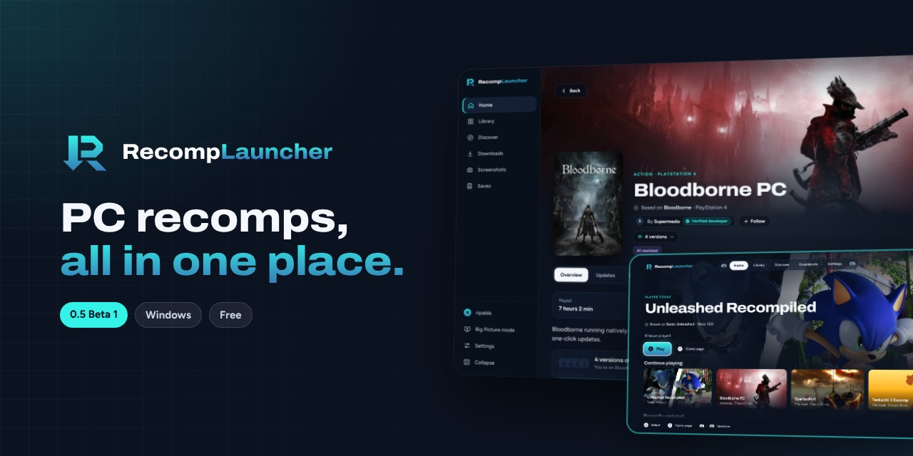
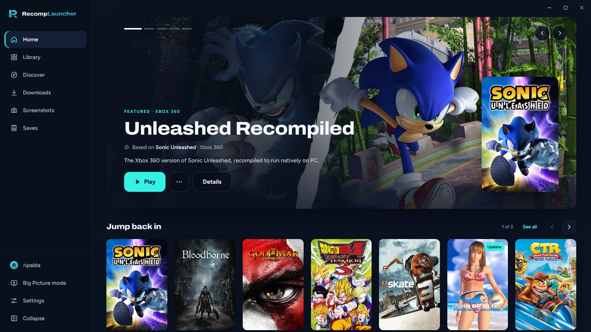
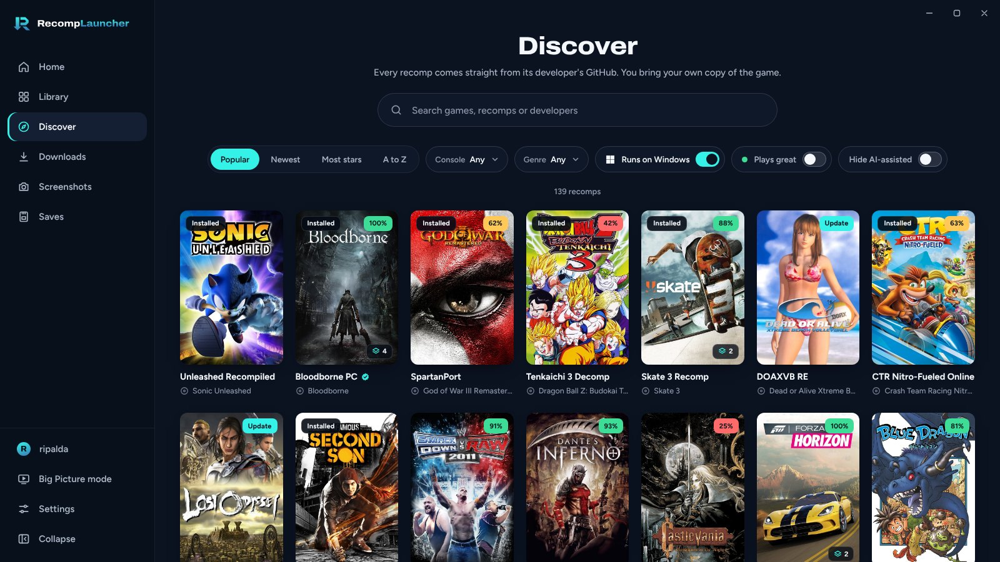
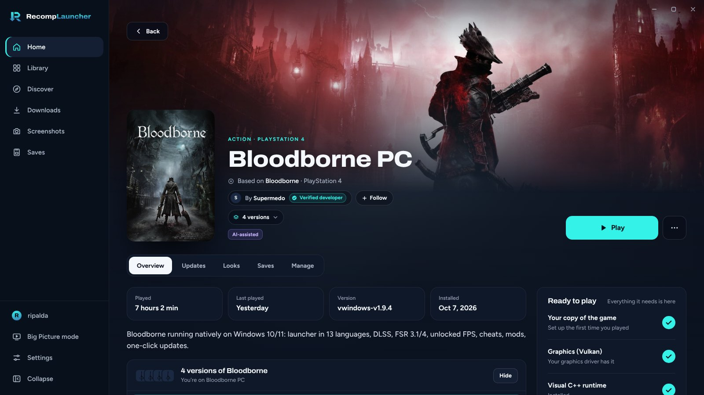
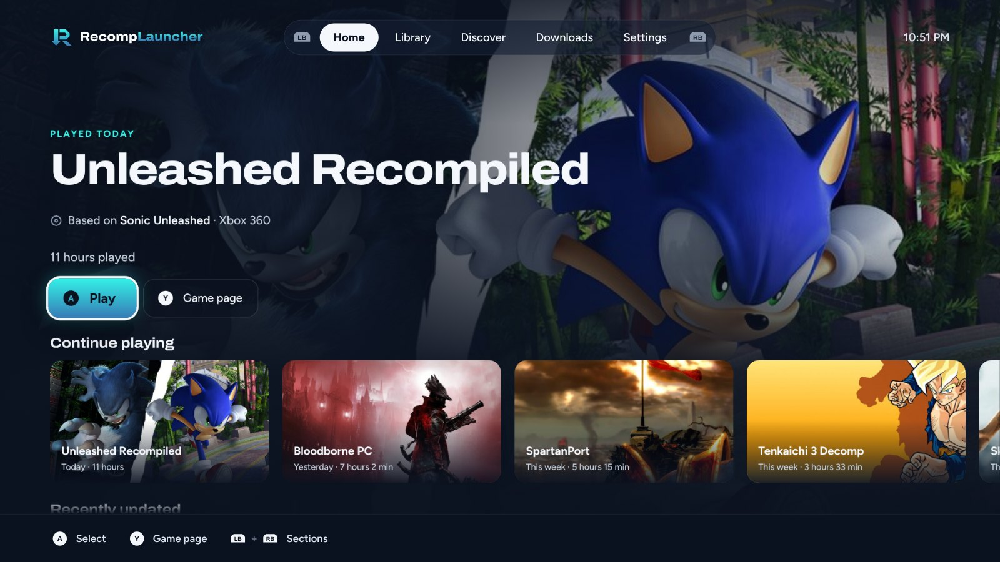
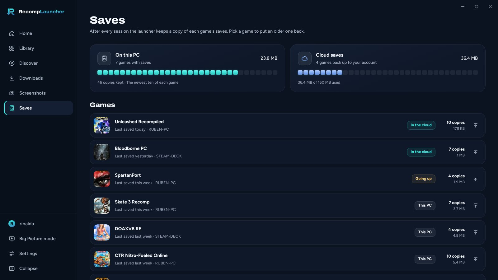

  <a href="https://github.com/elripalda/RecompLauncher/releases/latest"><b>Download the beta</b></a> ·
  <a href="https://recomplauncher.com">recomplauncher.com</a> ·
  <a href="https://discord.gg/FUzqGM2cvf">Discord</a>

---

RecompLauncher finds, installs, updates and plays PC recomps: native PC versions of console
games, made by their developers from the original game. You bring your own copy of the game and
the launcher sets it up.

## What's in it

- **Discover:** every recomp on recomplauncher.com, with screenshots, what it needs and how it
  runs for other players.
- **Install and update in one click,** straight from the developer's own GitHub release. Every
  download is checked against GitHub's checksum.
- **Easy setup:** point it at your disc image or game folder and it does the rest, for the recomps
  that support it.
- **Versions:** games with more than one recomp show once, and you can switch between versions or
  keep a few side by side.
- **Saves:** backups before every update, and cloud saves with a free account.
- **Big Picture mode:** a full-screen view for a controller and a TV.
- **Looks:** CRT and other screen effects, per game.
- **Player reports:** see how a recomp runs for people before you install it, and add your own.
- **Verified developers:** follow the people making the recomps you like and hear when they put
  out something new.

## A look around

<table>
  <tr>
    <td width="50%">
<b>Discover</b>
</td>
    <td width="50%">
<b>A game's page</b>
</td>
  </tr>
  <tr>
    <td width="50%">
<b>Big Picture mode</b>
</td>
    <td width="50%">
<b>Saves</b>
</td>
  </tr>
</table>

## Get it

Windows 10 or 11, 64-bit. Linux is next, Mac after that.

Download the setup file from [Releases](https://github.com/elripalda/RecompLauncher/releases/latest)
and run it. While the beta is new, Windows may say "Windows protected your PC". Click
**More info**, then **Run anyway**. Each release lists its file's SHA-256 so you can check you
have the real one.

## No game files

RecompLauncher has no game files and never downloads any. Every recomp comes from its developer's
GitHub, and you set it up with your own copy of the game.

## Found a bug? Have an idea?

The quickest way is **Settings > Beta** in the launcher. It goes straight to the developer and can
include your PC's details. You can also post in the [Discord](https://discord.gg/FUzqGM2cvf) or
[open an issue](https://github.com/elripalda/RecompLauncher/issues/new/choose) here.

If a game crashes, send the log from the crash screen. Every one helps.

## Making a recomp?

Add a `recomplauncher.json` to your release and players get one-click setup, your settings inside
the launcher, and Big Picture mode support. The guide is in [docs/DEVELOPERS.md](docs/DEVELOPERS.md),
with examples in [docs/examples](docs/examples).

## About

Made by [Ripalda](https://github.com/elripalda). If you'd like to support it: [Ko-fi](https://ko-fi.com/ripalda).

RecompLauncher is free to download and use. It isn't affiliated with or endorsed by any game's
makers or platform holders.
