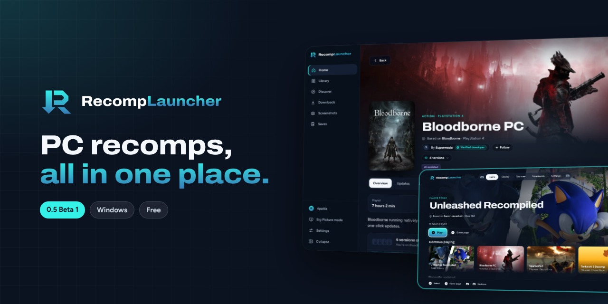
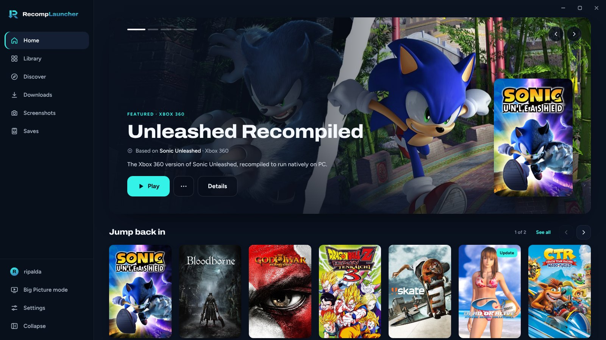
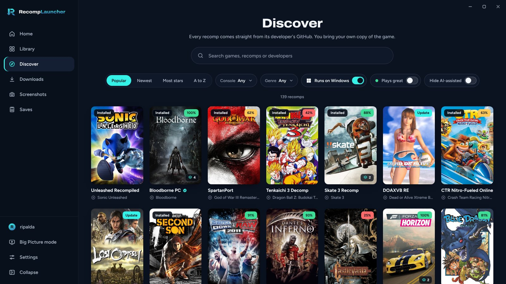
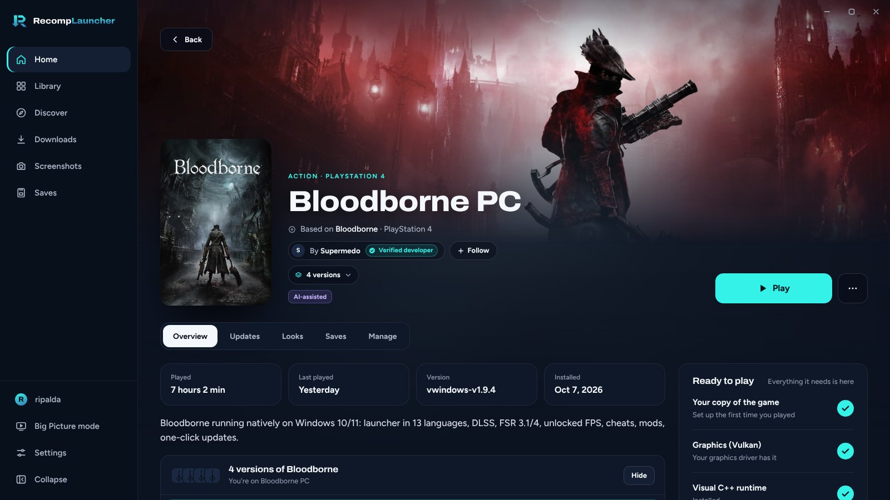
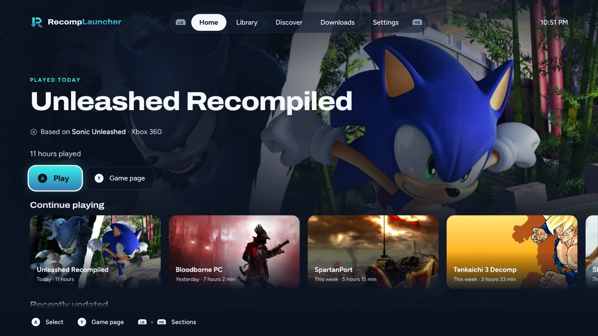
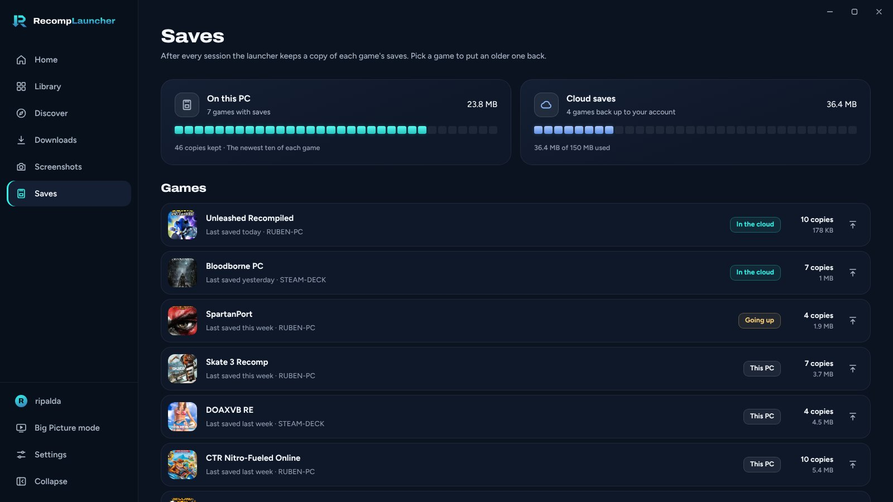

  <a href="https://github.com/elripalda/RecompLauncher/releases/latest"><b>Tải bản beta</b></a> ·
  <a href="https://recomplauncher.com">recomplauncher.com</a> ·
  <a href="https://discord.gg/FUzqGM2cvf">Discord</a>

  
  
  

  <a href="README.md">English</a> · <b>Tiếng Việt</b>

---

RecompLauncher tìm, cài đặt, cập nhật và chơi các bản recomp PC: những phiên bản PC native của
game console, do chính nhà phát triển của chúng tạo ra từ game gốc. Bạn mang theo bản game của
riêng mình và launcher sẽ lo phần cài đặt.

## Có gì trong này

- **Catalog:** mọi bản recomp trên recomplauncher.com, kèm ảnh chụp màn hình, những thứ nó cần
  và cách nó chạy trên máy của những người chơi khác.
- **Coming Soon:** các bản recomp sắp ra mắt. Lưu một bản và launcher sẽ báo cho bạn khi nó phát
  hành (cả qua email khi bạn đã đăng nhập), và Request a Recomp để đề xuất một dự án trên GitHub
  hoặc GitLab.
- **Cài đặt và cập nhật chỉ với một cú nhấp,** lấy thẳng từ bản phát hành GitHub của chính nhà
  phát triển. Mọi lượt tải xuống đều được kiểm tra đối chiếu với checksum của GitHub.
- **Easy Setup:** chỉ cần trỏ nó tới ảnh đĩa hoặc thư mục game của bạn và nó sẽ làm phần còn
  lại, đối với các bản recomp có hỗ trợ tính năng này.
- **Versions:** game có nhiều hơn một bản recomp chỉ hiển thị một lần, và bạn có thể chuyển đổi
  giữa các phiên bản hoặc giữ vài bản cạnh nhau.
- **Saves:** sao lưu trước mỗi lần cập nhật, và lưu trữ đám mây với một tài khoản miễn phí.
- **Big Picture mode:** chế độ xem toàn màn hình dành cho tay cầm và TV.
- **Looks:** CRT và các hiệu ứng màn hình khác, cho từng game.
- **Player reports:** xem một bản recomp chạy thế nào với mọi người trước khi bạn cài nó, và
  thêm báo cáo của riêng bạn.
- **Verified developers:** theo dõi những người đang làm các bản recomp bạn thích và biết khi họ
  ra mắt sản phẩm mới.

## Dạo một vòng

<table>
  <tr>
    <td width="50%">
<b>Catalog</b>
</td>
    <td width="50%">
<b>Trang của một game</b>
</td>
  </tr>
  <tr>
    <td width="50%">
<b>Big Picture mode</b>
</td>
    <td width="50%">
<b>Saves</b>
</td>
  </tr>
</table>

## Tải về

Windows 10 hoặc 11, 64-bit. Hỗ trợ macOS bước đầu nhắm tới Apple Silicon: xem
[Hướng dẫn build và test-artifact cho Mac](docs/BUILDING.md#macos-initial-apple-silicon-support).
Các bản build thử nghiệm cho Mac hỗ trợ game Mac native đóng gói dạng ZIP, DMG, RAR hoặc 7z và không phải là bản phát hành đã được Apple công chứng. Nếu macOS chặn lần khởi chạy đầu tiên vì không thể xác minh nhà phát triển, hãy làm theo [Các bước mở lần đầu trên Mac](docs/TROUBLESHOOTING.md#macos-cannot-verify-the-developer).

Arch Linux x86_64 có bản build native `.pkg.tar.zst`: xem
[Hướng dẫn gói Arch](packaging/arch/README.md) để build và cài đặt nó bằng pacman.

NixOS và Nix (x86_64): `nix run github:elripalda/RecompLauncher`, hoặc xem
[Hướng dẫn Nix](packaging/nix/README.md) để cài đặt nó cùng hệ thống của bạn.

Tải file cài đặt từ [Releases](https://github.com/elripalda/RecompLauncher/releases/latest)
và chạy nó. Trong lúc bản beta còn mới, Windows có thể hiện "Windows protected your PC". Nhấn
**Thông tin thêm**, rồi **Vẫn chạy**. Mỗi bản phát hành đều liệt kê SHA-256 của file của nó để bạn kiểm tra
bạn đang có đúng file thật.

Trong **Settings > General > When you close the window**, tùy chọn **Close to tray** kiểm soát việc
đóng cửa sổ có giữ RecompLauncher trong khay hệ thống hay không. Tắt nó đi để thoát launcher
và công việc nền của nó khi bạn đóng cửa sổ. **Quit RecompLauncher** thì luôn thoát.
Tùy chọn này cũng có trong chế độ Big Picture. Nó tắt theo mặc định đối với các bản cài đặt mới;
các lựa chọn đã lưu trước đó được giữ nguyên. Game đang chạy vẫn tiếp tục chơi.

**Settings > General > Starting up > Start with your PC** khởi động RecompLauncher khi bạn đăng
nhập, chờ sẵn trong khay hệ thống. Mục này nằm trong danh sách khởi động riêng của hệ thống của bạn (Startup apps
trên Windows, Autostart trên KDE Plasma và GNOME, Login Items trên Mac), nên bạn cũng có thể tắt nó
ở đó. Bản Flatpak hỏi desktop của bạn thông qua Background portal của nó. Trên Mac (macOS 13 hoặc
mới hơn) cửa sổ sẽ mở ngay khi đăng nhập thay vào đó. Nó tắt theo mặc định và cũng vậy trong chế độ Big Picture.

## Không có file game

RecompLauncher không có file game nào và không bao giờ tải xuống bất kỳ file nào. Mọi bản recomp đều đến từ
GitHub của nhà phát triển của nó, và bạn cài đặt nó bằng bản game của riêng mình.

## Thấy lỗi? Có ý tưởng?

Cách nhanh nhất là **Settings > Beta** trong launcher. Nó đi thẳng tới nhà phát triển và có thể
kèm theo thông tin chi tiết về PC của bạn. Bạn cũng có thể đăng trong [Discord](https://discord.gg/FUzqGM2cvf) hoặc
[mở một issue](https://github.com/elripalda/RecompLauncher/issues/new/choose) tại đây.

Nếu một game bị crash, hãy gửi log từ màn hình crash. Mỗi log đều giúp ích.

## Đang làm một bản recomp?

Thêm một `recomplauncher.json` vào bản phát hành của bạn và người chơi sẽ có cài đặt một cú nhấp, phần cài đặt của bạn ngay trong
launcher, và hỗ trợ chế độ Big Picture. Hướng dẫn nằm trong [docs/DEVELOPERS.md](docs/DEVELOPERS.md),
với các ví dụ trong [docs/examples](docs/examples). [docs/ADD-SUPPORT.md](docs/ADD-SUPPORT.md) là
danh sách kiểm tra để thêm hỗ trợ cho một bản recomp.

## Mã nguồn

Toàn bộ mã nguồn của launcher ở đây: lõi Rust trong `src-tauri/` và cửa sổ trong `ui/`. Bạn
có thể đọc chính xác nó làm gì, hoặc tự build nó bằng các bước trong
[docs/BUILDING.md](docs/BUILDING.md). Nó được cấp phép theo GPL v3 ([LICENSE](LICENSE)).

## Số sao theo thời gian

## Giới thiệu

Được làm bởi [Ripalda](https://github.com/elripalda). Nếu bạn muốn ủng hộ dự án: [Ko-fi](https://ko-fi.com/recomp).

RecompLauncher miễn phí để tải xuống và sử dụng. Nó không liên kết với, cũng không được xác nhận bởi, bất kỳ
nhà sản xuất game hay chủ sở hữu nền tảng nào.
