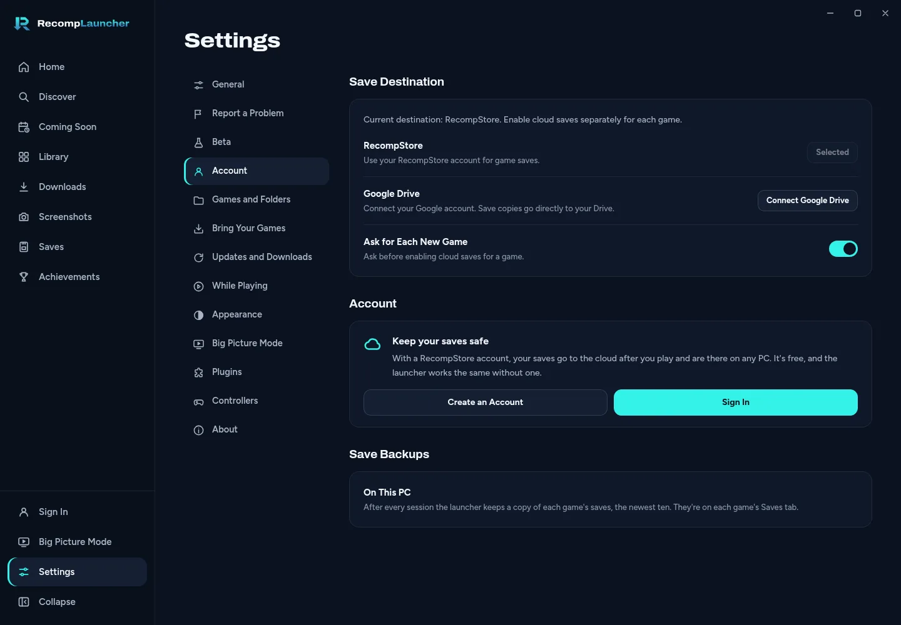
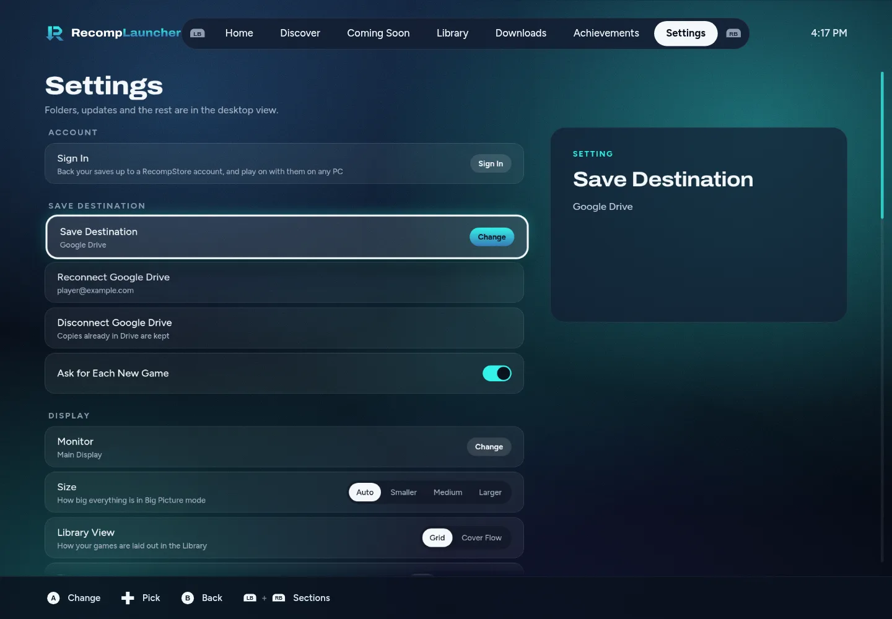

# Google Drive saves

Open **Settings → Account → Save destination → Connect Google Drive**. Choose your Google
account in the browser and approve access. Then choose **Use Google Drive** and enable cloud
saves on each game's **Saves** tab. A RecompStore account is not required for Drive saves.

The launcher creates a visible **RecompLauncher/Saves** folder in My Drive. Copies are ZIP
archives using the same `rlsave.json` format as local backups. The launcher requests only
`drive.file`: access to files it creates or the user explicitly opens with it. It does not
request access to the rest of your Drive. Files and credentials travel directly to Google;
RecompLauncher servers do not receive them.

Google sign-in requests and save transfers follow **Settings → Network → Proxy**. Changes
apply without restarting the launcher, including choosing **Off** to bypass system proxies.

Before play, the launcher checks for another PC's saves. After play it makes a local backup
and uploads changed saves. **Sync Now** checks immediately. Offline saves wait on this PC
and retry later, including after restarting the launcher. Connect the same Google account
on each PC and enable the same games there.

When both PCs changed their saves, choose which to use. Simultaneous uploads are tracked by
snapshot ancestry, rather than assuming the PC with the later clock has the right save.
The other copies remain available in the Saves tab. The newest five ordinary cloud copies
are kept; unresolved branches retain their history until resolved. Removed old copies go
to Drive's Trash, which still uses Google storage until emptied. Local backups retain their
existing limit of ten copies per game. The upload limit remains 95 MiB per archive, along
with the existing save discovery and file limits.

Switching providers or connecting a different Google account requires enabling games again.
Existing copies are not moved between providers. **Disconnect** stops this PC's Drive sync
and removes its Google credentials; local saves and remote copies remain. You can separately
remove RecompLauncher's access in your Google account's connected-app settings. Google's
revocation can disconnect other PCs too.

Big Picture has the same connection, provider selection, per-game switch and sync controls.
It normally opens the browser on the same PC. Approved limited-input builds can offer a
Google device code and QR code for a phone. A phone cannot finish a desktop loopback callback.

The save destination controls in desktop and Big Picture:





## Configuring a release build

The project maintainer must configure one Google Cloud project, enable the Drive API, configure
Google Auth branding/audience/data access, and register a **Desktop app** OAuth client. Ordinary
players only connect their Google account; they do not create a Cloud project or paste credentials.

Set these environment variables when building the launcher:

```sh
export RL_GOOGLE_CLIENT_ID='your-desktop-client.apps.googleusercontent.com'
export RL_GOOGLE_CLIENT_SECRET='the-desktop-client-secret'
npm run build
```

These are installed-app client credentials, which are distributed with the binary and cannot
be treated as confidential. Keep development and production projects separate. Use the same
production Google project across platforms so the application can discover the same files.
The launcher embeds these build variables; changing them requires rebuilding. Without a desktop
client ID, desktop connection controls explain that this build has not configured Drive.

Publish the OAuth application for external users and complete Google's applicable branding and
verification requirements before releasing it. In Google's Testing status, Drive refresh tokens
expire after seven days. Test denied consent, revoked access, and the production consent screen
before shipping.

Only if the application qualifies for Google's TV/limited-input flow, register an additional
**TVs and Limited Input devices** client in that same project and set:

```sh
export RL_GOOGLE_DEVICE_CLIENT_ID='your-approved-device-client.apps.googleusercontent.com'
export RL_GOOGLE_DEVICE_CLIENT_SECRET='the-device-client-secret'
```

Big Picture uses that client when configured and respects Google's polling interval and slow-down
responses. Without it, Big Picture uses the desktop browser flow. Do not register a desktop
application as a limited-input device merely to avoid browser sign-in.

Google refresh tokens use a separate Windows Credential Manager entry. On Linux and macOS they
follow the launcher's existing convention: an atomically replaced file readable only by its owner
in the launcher data directory. Tokens and upload-session URLs are not sent to the UI or logged.
Native keychain integration on Linux/macOS is not included. Upload-session state stays in the
launcher data directory and is scoped to the Google account and game, even when the local backup
folder is on a synchronized drive.

No `recomplauncher.json` changes are needed. Existing `saves` paths and managed-input exclusions
apply to Drive backups too. Downloads are checked against the archive manifest and individual
file hashes before restoration, and archive destinations must match this PC's known save folders
(or the folders the player explicitly picked).
File-count and total-size limits are checked separately for each save location, matching backup
discovery when a game saves in several folders.

## Reviewing the UI without a Google account

On Linux with Google Chrome installed, run:

```sh
node tools/check-google-drive-ui.cjs
```

Set `RL_UI_CHROME` to another Chrome executable if needed. An optional directory argument chooses
where the check writes its screenshots and results; otherwise it uses a new temporary directory.
It exercises the shipped desktop and Big Picture UI with simulated Tauri responses, including
connection cancellation, missing OAuth configuration, connected account controls, and keyboard navigation.
It never signs into Google or changes your launcher data. The screenshots above use this simulated
state and a sample account address. Native launcher and live Google validation are separate checks.

## Validation before a public release

Run `cargo test --manifest-path src-tauri/Cargo.toml` and `node --test tests/*.test.cjs`.
With the production OAuth configuration, test two real installations on Windows and Linux/Steam
Deck: connect the same account, upload, restore, play offline and reconnect, interrupt an upload,
create simultaneous changes, resolve both choices, switch accounts, and disconnect. Also check
a full Drive, a manually damaged ZIP, expired/revoked authorization, and Big Picture controls.
Automated tests do not replace this live Google authorization and storage check.

Google documentation:

- [Desktop OAuth, PKCE and loopback redirects](https://developers.google.com/identity/protocols/oauth2/native-app)
- [Drive scopes](https://developers.google.com/workspace/drive/api/guides/api-specific-auth)
- [Resumable uploads](https://developers.google.com/workspace/drive/api/guides/manage-uploads)
- [Device authorization and supported scopes](https://developers.google.com/identity/protocols/oauth2/limited-input-device)
- [Refresh token expiration](https://developers.google.com/identity/protocols/oauth2#expiration)
